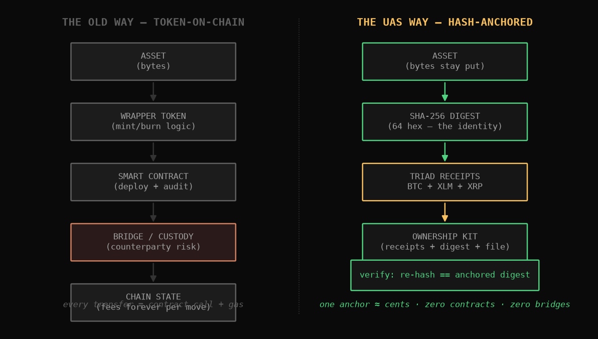
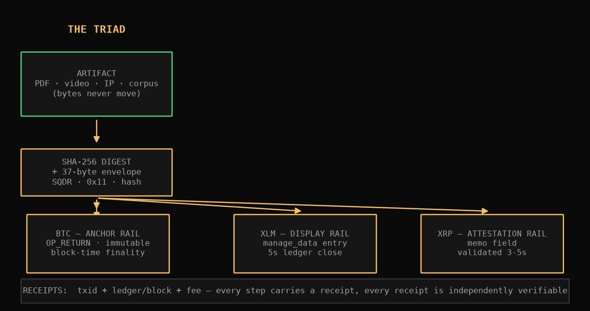
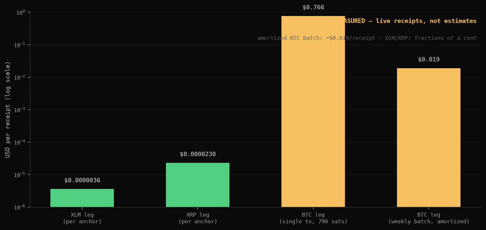
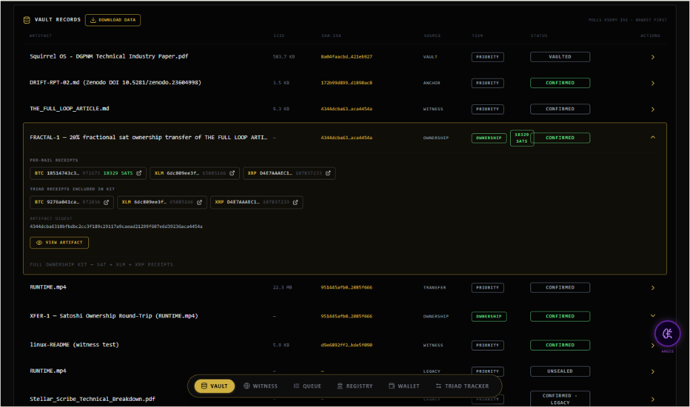
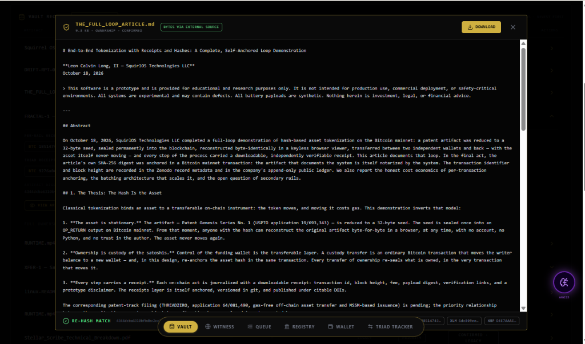

# The Chain Is the Witness, Not the Asset

## Why tokenization no longer requires tokens on-chain — thesis and practitioner walkthrough

**Leon Calvin Long, II — SQUIRL OS Technologies LLC**
October 2026

> This software is a prototype and is provided for educational and research purposes only. It is not intended for production use, commercial deployment, or safety-critical environments. All systems are experimental and may contain defects.

---

# PART I — THE THESIS

## I.2. The problem: the token-on-chain cost stack

The conventional pipeline for "putting something on-chain" is a stack of recurring costs and compounding risks:



**Cost stack.** A tokenized asset requires wrapper-token design, smart-contract deployment, and — for anything touching value — professional audits. Then every state change (transfer, fractional sale, burn) is a contract call that pays gas, forever. Fees do not decay to zero; they track network congestion, which is precisely when an owner can least afford friction.

**Risk stack.** Bridges remain the largest recurring loss vector in the industry, with billions of dollars exploited across 2021–2022 alone. Every bridge is a honeypot guarding the very value the token was supposed to protect. Add contract vulnerabilities, key-custody failures, and upgrade governance disputes, and the token-on-chain model concentrates risk at exactly the layer that was supposed to be trustless.

**Regulatory stack.** A minted wrapper token is, in most jurisdictions, a security-shaped object. Issuing one drags the asset into securities analysis, custody rules, and transfer restrictions — overhead that has nothing to do with the artifact itself.

The shared root cause: the token **is** the asset in this model, so every protection must surround it.

---

## I.3. The thesis: the hash is the asset's identity — the chain is the witness

The UAS inverts the model:



1. **The artifact is stationary.** A PDF, a video, an IP bundle, a corpus root — the bytes stay wherever the owner keeps them. Nothing is uploaded to a chain.
2. **The digest is the identity.** A SHA-256 hash (64 hexadecimal characters) is the artifact's fingerprint. Two files with the same digest are the same file, byte-for-byte.
3. **The triad is the receipt.** A 37-byte envelope (`SQDR` prefix + type byte + digest) is written to three independent rails: a Bitcoin `OP_RETURN` anchor rail (immutable, block-time finality), a Stellar `manage_data` display entry (named, human-discoverable, ~5-second ledger close), and an XRP memo attestation (validated, ~3–5 seconds).
4. **Verification is deterministic.** Anyone can re-hash the file and match it against the anchored digest. No contract to audit, no bridge to trust, no token to custody. The verification math is a comparison.

**Ownership does not require a token.** Ownership is custody of the underlying value — including the satoshis themselves. A sat held in the owner's wallet, with its provenance chain-anchored, is more directly owned than any wrapped representation of it. Receipts transfer evidence; custody transfers ownership; neither requires minting anything.

---

## I.4. Unit economics — measured, not estimated

Every number in this section comes from live production anchors executed by the UAS, receipts on file:

| Leg | Mechanism | Native fee | Measured speed |
|---|---|---|---|
| Bitcoin (anchor rail) | OP_RETURN, weekly batched | 790 sats single-tx (recent anchor) | block-time finality (~5 min observed) |
| Stellar (display rail) | manage_data, named entry | 100 stroops | 6.7 s measured |
| XRP (attestation rail) | memo field | 10 drops | 6.8 s measured |



Under weekly batch amortization on Bitcoin mainnet, the structural floor for full tri-rail provenance is **~$0.019 per receipt**. Native-unit fees (stroops, drops, sats) are fractions of a cent per leg; USD conversions move with market prices, which is itself an argument for the batching doctrine — costs are pinned in the most stable unit available (sats) and amortized.

Contrast that with the token-on-chain stack: five-to-six-figure contract audit programs, gas on every transfer for the asset's entire life, and bridge exposure measured in existential-loss events. The UAS stack's total infrastructure cost is measured in **cents per artifact, one time**.

**Fee-market independence.** Because the triad spans three fee markets, a congestion event on any single rail degrades nothing — the other two receipts remain cheap and fast. The BTC leg is capped at a dynamic fee ceiling (30 sat/vB doctrine) and rides the batcher, so even the anchor leg is insulated.

---

## I.5. Proof of capability — worked examples with receipts

These are not mockups. Each example below carries live transaction IDs on three public networks.

**DGPNM Technical Industry Paper (core IP, U.S. provisional 64/119,191 lineage).** Anchored as a live demonstration: XLM landing in 6.7 seconds (ledger 65134355), XRP attesting in 6.8 seconds, BTC broadcast at 790 sats. The artifact was then pulled back from the vault and reconstructed byte-exact — the re-hash matched the anchored digest on all 64 hex characters.

**FRACTAL-1 — fractional sat ownership, without a token.** A 20% fractional ownership transfer of an article artifact, settled as 18,329 sats of actual satoshi value with triad receipts. The fraction is a fact witnessed by the chain; the satoshis are the asset. No ERC-fraction, no fractionalized wrapper, no vault contract.

**XFER-1 — satoshi ownership round-trip.** A full ownership transfer and return of a video artifact (RUNTIME.mp4) proved that ownership can move and revert across the triad with receipts at every hop — the "full loop" of the tokenization lifecycle, without a single token minted.

**HEMI-DRIFT-1 — artifact reconstruction.** A drift report anchored across all three rails (BTC block 973108, XLM ledger 65133551) and reconstructed from vault bytes with a byte-exact re-hash match. Anchor → verify → reconstruct, end to end.

**Certification bundles.** The company's own governance and certification artifacts run through the same machinery: HG-CERT-1 (Zenodo DOI 10.5281/zenodo.23627901, BTC block 972981) and SOV-B1 (Zenodo DOI 10.5281/zenodo.23628676, BTC block 972987, XLM ledger 65119590) both carry triad anchors with verified readbacks.

---

## I.6. The product surface



The Vault presents every anchored artifact with its size, SHA-256, tier, and status; each row expands into its full ownership kit — per-rail receipts (BTC, XLM, XRP) with explorer links, the artifact digest, and direct artifact viewing.



The viewer shows the artifact itself alongside its provenance: the re-hash match footer, the anchored digests, and rail receipts. In an investor or diligence context, this is the difference between *claiming* provenance and *showing* it.

---

## I.7. Why this wins — the moat

1. **Patented machinery.** 13 patents pending (U.S. provisional 19/693,343 + twelve provisionals) covering the anchoring, healing, and orchestration architecture. The triad doctrine and the deterministic receipt model are the core of the portfolio.
2. **Cost as strategy.** At ~1.9 cents per receipt, anchoring is economical for artifacts that no token-stack would ever touch: research datasets, compliance records, media provenance, chain-of-custody files. The addressable volume is the long tail the incumbents cannot serve.
3. **Rail-agnostic by design.** The UAS treats chains as interchangeable witnesses. New chains, fee shifts, or regulatory reclassification of a given rail are configuration, not architecture.
4. **The receipts compound.** Every anchor strengthens the pattern library and the public record — the system's own certification trail (published, DOI-cited) is its strongest reference.
5. **Post-quantum posture.** PQC-validated signing doctrine (CRYSTALS-Dilithium3 / kyber_1024 / SPHINCS+-256f) across the stack positions the provenance layer for the decade in which hash agility becomes a procurement requirement.

---

## I.8. Honest limitations

- All deployments are **prototype packages**; buyers complete production hardening themselves. No production warranty is implied or offered at any tier.
- BTC confirmation latency is block-time (minutes, not seconds); the XLM/XRP legs exist precisely to give the receipt sub-10-second availability while BTC finality lands.
- USD fee conversions fluctuate with market prices; the batching doctrine pins the structural floor in sats.
- Regulatory treatment of digest-anchoring (as opposed to token issuance) is favorable by construction, but jurisdiction-specific diligence remains the buyer's responsibility.

---

## I.9. Conclusion

Tokenization spent a decade trying to make the chain hold the asset. The UAS proves the chain's comparative advantage is holding **the witness**. The result is provenance at a cost floor that unlocks high-volume anchoring, ownership grounded in custody of real value rather than wrappers, and a receipt architecture with no contract attack surface and no bridge to guard.

The receipts are public. The economics are measured. The machinery is patented. What remains is scale.

---

**Leon Calvin Long, II**
SQUIRL OS — Self-Healing AI Infrastructure
DCAI: zenodo.org/communities/dcai · DSOS Science: science.squirlos-technologies.com

*This paper is part of the DCAI research corpus. Reproduction of the measured figures requires citation of the underlying receipts.*

---

# PART II — THE PRACTITIONER'S WALKTHROUGH

## II.1. What "tokenization" should mean

Strip away the wrapper-token machinery and tokenization reduces to three claims an owner wants to make about an artifact, and have independently verifiable:

1. **Existence** — this exact artifact existed at this time.
2. **Integrity** — it has not been altered since.
3. **Ownership** — who held it, and when that changed.

None of these claims require a token on a chain. They require a **witnessed fingerprint**. The UAS lifecycle below is how each claim is produced, receipted, and verified. The worked example throughout is a live anchor of a core-IP technical paper (U.S. provisional 64/119,191 lineage), executed on October 25, 2026.

---

## II.2. The lifecycle, step by step

### II.2.1 Step 1 — Vault the artifact
The file enters the ArtifactVault unchanged: bytes are stored under owner custody, and nothing is uploaded to any chain. The vault entry records file name, size, and tier. Status: `VAULTED`.

### II.2.2 Step 2 — Compute the identity
A SHA-256 digest is computed over the file's bytes. In the worked example:

```
8a04faacbd4c8584581f38c2acf76250f1ea2be2e644b320e6a20c8e421eb927
```

This 64-hex string is the artifact's identity for all anchoring purposes. Two files with the same digest are the same file, byte-for-byte — that is the entire trust root, and it is deterministic arithmetic, not a contract.

### II.2.3 Step 3 — Envelope and queue
The digest is wrapped in a 37-byte envelope: `SQDR` prefix + type byte `0x11` + raw hash. Hash-only, never bytes. An anchor job is queued (status `QUEUED`) with the routing doctrine: SAT anchor rail, XLM display rail, XRP attestation rail, and the fee caps — BTC dynamic cap 30 sat/vB, XLM 100 stroops, XRP 10 drops.

### II.2.4 Step 4 — Fire the triad
One job fires all three legs in parallel:

- **Bitcoin** — the envelope is written into an `OP_RETURN` output (prunable, never executable). Worked example: broadcast at a 790-sat fee; block-time finality follows.
- **Stellar** — a `manage_data` entry named for the job carries the envelope on a ledger that closes every ~5 seconds. Worked example: **landed in 6.7 seconds, ledger 65134355**.
- **XRP** — a transaction memo carries the envelope as an attestation. Worked example: **validated in 6.8 seconds**.

Each leg returns a receipt: transaction ID, ledger or block reference, fee, and timestamp. Job status moves through `fired → attested → broadcast → processing` as writebacks land.

### II.2.5 Step 5 — Confirmation and readback
The XLM and XRP receipts are final within seconds. The BTC leg confirms with block inclusion. The readback pulls each receipt from the public ledger and verifies the envelope content matches the vaulted digest. Job status: `ANCHORED`. The Registry row goes live with all three explorer links.

### II.2.6 Step 6 — Verify (anyone, anytime)
Verification never requires the UAS. A third party with only the file and the public receipts:

1. hashes the file,
2. compares against the digest embedded in the three on-chain envelopes,
3. checks explorer records for the receipts.

Three independent consensus networks must all be corrupted simultaneously to forge a receipt — and the Bitcoin leg sets the tamper-evident floor regardless.

### II.2.7 Step 7 — Reconstruct
The strongest proof of the loop: pull the artifact bytes back from the vault and re-hash them. In the worked example the reconstruction matched the anchored digest on all 64 hex characters — `DELIVERED`, byte-exact. Anchor, verify, reconstruct: the artifact never left custody, and its identity survived the round trip.

---

## II.3. Ownership transfers, without a token

The same lifecycle extends to ownership movement:

- **FRACTAL-1** — a 20% fractional ownership transfer of an article artifact settled as 18,329 sats of actual satoshi value, with triad receipts at each hop. The fraction is witnessed by the chain; the satoshis are the asset.
- **XFER-1** — a full satoshi ownership round-trip on a video artifact: transfer out, return, receipts at every hop, byte-exact reconstruction at the end.

Ownership changes are receipts plus custody — never a minted wrapper. This is what "tokenization actually works like" when the token is removed: the evidence is on-chain, the value stays where custody already lives.

---

## II.4. Cost of the lifecycle

Per-artifact structural cost under weekly batching: **~$0.019 per receipt** across all three rails. Fees are pinned in native units (sats, stroops, drops); sub-10-second receipt availability comes from the XLM/XRP legs while BTC finality lands in block time. There is no gas-per-transfer: ownership movements ride the same triad, so marginal cost after anchoring is another receipt, not a contract call.

---

## II.5. Practitioner's checklist

| Stage | Artifact state | Receipt produced | Status |
|---|---|---|---|
| Vault | bytes stored, unmoved | vault entry | VAULTED |
| Digest | identity computed | sha256 in job | QUEUED |
| Triad | envelope on 3 rails | txid + ledger/block + fee | PROCESSING |
| Confirm | readback verified | 3/3 receipt readback | ANCHORED |
| Verify | third-party re-hash | public explorer records | — |
| Reconstruct | bytes pulled, re-hashed | byte-exact match | DELIVERED |

---

## II.6. Conclusion

Tokenization, done correctly, is not the act of putting an asset on a chain. It is the act of making an asset's existence, integrity, and ownership independently and cheaply provable — while the asset itself never moves. The UAS lifecycle shows the entire arc in receipts a practitioner can pull today, ending with the only test that matters: the bytes come back, and the hash matches.

---

**Leon Calvin Long, II**
SQUIRL OS — Self-Healing AI Infrastructure
DCAI: zenodo.org/communities/dcai · DSOS Science: science.squirlos-technologies.com

*This paper is part of the DCAI research corpus. Reproduction of the measured figures requires citation of the underlying receipts.*
